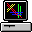
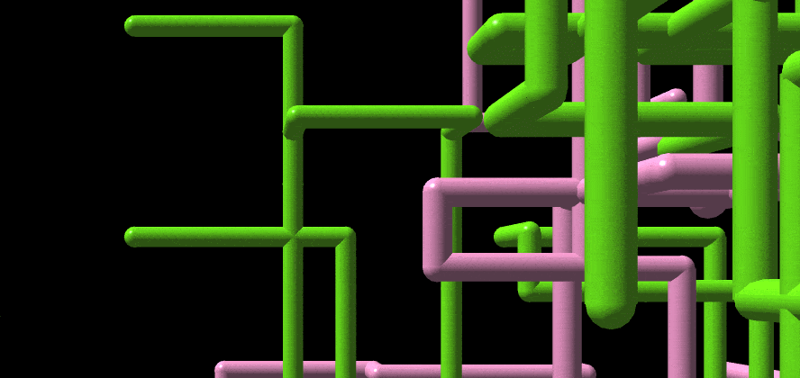

# [ Pipes](https://1j01.github.io/pipes/)

A web-based remake of the Windows 3D Pipes screensaver (3D Pipes.scr or sspipes.scr) using [Three.js](https://threejs.org/)

Includes both [Utah Teapots](https://en.wikipedia.org/wiki/Utah_teapot) and candy cane easter eggs! (with increased chances 😏)

[Check it out!](https://1j01.github.io/pipes/)

It's also included in [98.js.org](https://98.js.org/) as a program you can run.

[](https://1j01.github.io/pipes/)

(This screen capture GIF is outdated. It now avoids collisions between pipes, has curved elbow joints, fades out between scenes, and has more options.)

## Options

The panel in the top left lets you change the joint type, speed, zoom, colors, texture, the transition between scenes (dissolve or fade), and the camera (still or slowly rotating). The mouse wheel zooms too. Your choices are saved in the browser.

You can also drop image files anywhere on the page (or use **Add images…**) to use them as pipe textures; with several, each pipe gets a different one.

Options can be given in the URL as JSON after the `#`, which is handy for embedding. These apply only to that page view and aren't saved:

```html
<iframe
  src="https://1j01.github.io/pipes/#{%22hideUI%22:true,%22speed%22:20,%22transition%22:%22fade%22}"
></iframe>
```

| Option       | Values                                             | Default      |
| ------------ | -------------------------------------------------- | ------------ |
| `joints`     | `"elbow"`, `"ball"`, `"mixed"`, `"cycle"`          | `"mixed"`    |
| `speed`      | pipe segments per second, `2` to `300`             | `60`         |
| `zoom`       | `0.5` to `3`; at `1` the whole grid fits on screen | `1.5`        |
| `palette`    | `"random"`, `"classic"`, `"materials"`             | `"random"`   |
| `texture`    | `"none"`, `"rusty"`, `"custom"`\*                  | `"none"`     |
| `transition` | `"dissolve"`, `"fade"`                             | `"dissolve"` |
| `camera`     | `"static"`, `"rotate"`                             | `"static"`   |
| `hideUI`     | `true`, `false`                                    | `false`      |

\* `"custom"` uses images you've added; until you add some, pipes are colored as usual.

## TODO

- Animate sections into existence, emulating CPU graphics where the triangles were drawn progressively and the screen updated in between "frames" (optionally)

- Improve lighting (the original was less shiny), or at least avoid unflattering camera angles

- Extra camera functions like following the pipes like a rollercoaster

- Implement different behavioral characteristics between pipes

- Follow-the-leader mode

- Update README GIF

- An API maybe?

## See Also

##### Mine / Affiliated

- [98.js: a recreation of the Windows 98 desktop](https://github.com/1j01/98)

- [NW Screensaver: a platform for running web pages as screensavers](https://github.com/1j01/nw-screensaver)

##### Unaffiliated

- [Screensaver Subterfuge: a game set in the 3D maze screensaver](https://poor-track-design.itch.io/screensaver-subterfuge)

## License

MIT-licensed; see [LICENSE](LICENSE) for details

## Development

### Live Server

You just need an HTTP server, but [Live Server](https://www.npmjs.com/package/live-server) is a great option, automatically reloading when you make changes.

### Prettier

[Prettier](https://prettier.io/) is used for code formatting.

To set up, including a pre-commit hook:

- Install [Node.js](https://nodejs.org/) if you don't already have it
- Run `npm i` in the project directory

A pre-commit hook can be surprising tho; formatting on save might be better...

### Reference Material

The source code for the original OpenGL screensavers can be found in [a version of the Windows SDK (for Windows NT 4.0)](https://winworldpc.com/download/3d03c2ad-c2ad-18c3-9a11-c3a4e284a2ef), in `MSTOOLS\SAMPLES\OPENGL\SCRSAVE`

(If you have a later version of the code, please let me know.)

### Project Structure

All the good stuff is in `screensaver.js`, in sections: options (defaults, saved choices and URL parameters), the grid, textures, materials, the `Pipe` itself, the scene and camera, transitions, scene cycling, the animation loop, and the UI.
